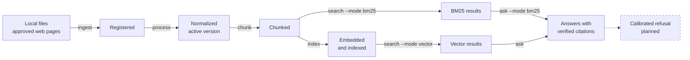
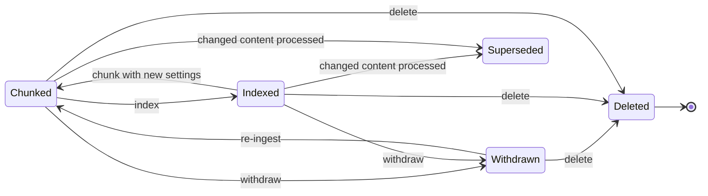
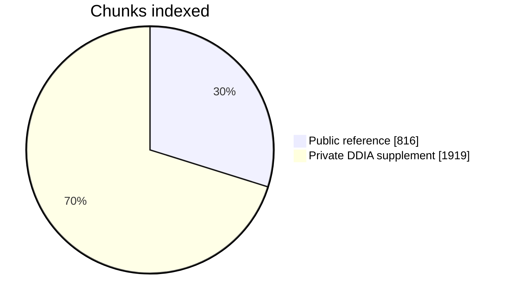

# TechDocQA
TechDocQA is a domain-specific RAG project for answering software and data engineering questions from technical documentation with source citations. It uses LangChain, local embeddings, a persisted Chroma index and BM25 search, and answers questions with a local Ollama model that cites the stored source of each claim. Calibrated refusal and NLP enrichment are planned.

## Current status

Phases 1-7 are implemented. You can ingest local files and approved web pages, normalize and chunk them, build a local index, search it by BM25 or vector similarity, ask questions with `ask`, withdraw or delete documents, and measure retrieval with `eval`.

On 10 smoke questions, `ask` answered all 10 with at least one verified citation, in a median of 17.8 s on this laptop. In a prompt-injection test, `qwen3:1.7b` ignored an injected instruction in 3 of 3 questions. **Answers are not yet released:** a person still has to rate whether the cited chunks support them (AC-16.6), and until Phase 8 calibrates a relevance threshold, `ask` also answers questions the documents do not cover, unless the model itself declines. See the [Phase 7 report](docs/PHASE_7_STATUS.md).

On the 30-question smoke benchmark, BM25 reaches Recall@5 0.925 and MRR 0.708, and vector search reaches Recall@5 0.925 and MRR 0.783. A run takes about 40 s and repeats exactly. The questions were reviewed and accepted by the project owner on 2026-11-03. See the [Phase 6 report](docs/PHASE_6_STATUS.md).

All 2,735 chunks are indexed: 816 from the 20-document public reference and 1,919 from the private DDIA supplement. Results survive a restart and a full rebuild unchanged. Two targets are not met: a query built from a chunk's sentence finds that chunk in the top 3 only 124 of 152 times on the real corpus (AC-12.1), and warm vector search has a p95 of 1.377 s against a 1 s target (NFR-02). See the [Phase 5 report](docs/PHASE_5_STATUS.md).

The selected local models are Ollama `qwen3:1.7b` and `nomic-embed-text:latest`. Installed metadata verifies the embedding model's BERT tokenizer family and 2,048-token input limit; its advertised `num_ctx=8192` does not override the API's metadata clamp. Exact provider token counting is unavailable, so chunks use recorded character counting plus a conservative UTF-8 bound: at most 1000 characters and 2,029 bytes, overlap 150, minimum 100. The generation tokenizer is independent. Offline tests and chunking never call a provider; embedding runs through local Ollama. OpenAI chunking profiles are accepted with `embedding_tokenizer = "tiktoken"` and a context window. The OpenAI chat adapter is wired, but its LangChain package is not installed, and OpenAI embeddings are not implemented.

**Jump to:** [Pipeline](#how-it-works) · [Search](#which-search-sees-what) · [Progress](#progress) · [Results](#measured-results) · [Ask](#asking-questions) · [Commands](#command-guide)

Select any section below to expand it.

## How it works



The SQLite registry decides what may be returned on every search. The BM25 and Chroma indexes are derived from it and can be rebuilt.

## Which search sees what



| Version state | BM25 | Vector |
|---|---|---|
| Chunked | ✅ | ❌ until `index` runs |
| Indexed | ✅ | ✅ |
| Withdrawn, superseded or deleted | ❌ | ❌ |

## Progress

| Phase | Scope | Status |
|---|---|---|
| 1-3B | Setup, registration, online HTML, normalization | ✅ Done |
| 4 | [Segmentation and chunking](docs/PHASE_4_STATUS.md) | ✅ Done |
| 5 | [Search and document lifecycle](docs/PHASE_5_STATUS.md) | ✅ Built, 2 targets open |
| 6 | [Smoke benchmark and retrieval metrics](docs/PHASE_6_STATUS.md) | ✅ Done, benchmark reviewed |
| 7 | [Answers and citations](docs/PHASE_7_STATUS.md) | ✅ Built, human answer review open |
| 8 | Calibrated refusal and P0 release | ⏭️ Next |
| 9-10 | NLP enrichment, hybrid search, reranking | ⬜ Planned |
| 11-12 | Operational verification, optional extras | ⬜ Planned |

## Measured results

| Check on the real corpus | Target | Result | |
|---|---|---|---|
| Top-5 after restart and rebuild | Identical | Identical | ✅ |
| Model calls on a repeat `index` or rebuild | 0 | 0 | ✅ |
| Technical identifiers at rank 1 | All tested | 8 of 8 | ✅ |
| BM25 warm p95 | At most 1 s | 0.138 s | ✅ |
| Vector warm p95 | At most 1 s | 1.377 s | ❌ |
| Sentence query finds its chunk in the top 3 | All | 124 of 152 | ❌ |
| Smoke benchmark, both modes | Under 5 min | 35 to 40 s | ✅ |
| Two benchmark runs, same inputs | Identical metrics | Identical | ✅ |
| Benchmark reviewed by a second person | Reviewed | All 30 accepted | ✅ |
| Smoke questions answered with a citation | 10 of 10 | 10 of 10 | ✅ |
| Injected instruction ignored by the model | Not followed | 3 of 3 | ✅ |
| Answers rated supported by a person | At least 8 of 10 | Not yet rated | ❌ |



## Command guide

<a id="reference-corpus"></a>
<details>
<summary><strong>Reference corpus</strong></summary>

The [2026-10-24 corpus report](docs/REFERENCE_CORPUS_STATUS.md) records 20 frozen public/openly licensed documents plus the existing private DDIA supplement: 21 documents, 2,700,598 bytes, five domains, four Markdown, 13 HTML, three text-based PDF excerpts and one TXT. Every selected version is normalized, finalized and active. The public selection meets the format/size/domain requirements without relying on DDIA's unverified permissions. See the [manifest](datasets/corpus_manifest.json) and [reproduction/verification instructions](datasets/README.md). Source material stays under ignored `data/`; the manifest contains provenance and hashes only.

</details>

<a id="offline-chunking"></a>
<details>
<summary><strong>Offline chunking</strong></summary>

Use explicit version IDs to chunk the frozen public selection, excluding DDIA and the rejected registry candidate:

```powershell
$referenceManifest = Get-Content datasets/corpus_manifest.json -Raw | ConvertFrom-Json
$referenceVersionIds = @($referenceManifest.documents | Where-Object evaluation_included | ForEach-Object version_id)
.\.venv\Scripts\techdocqa.exe chunk @referenceVersionIds
.\.venv\Scripts\techdocqa.exe status --status chunked --json
.\.venv\Scripts\python.exe datasets/verify_corpus.py
```

The private DDIA version was also chunked locally and remains excluded from public evaluation. `chunk` without IDs processes all active finalized nonduplicate registry versions; review selection is expressed by the version IDs. Repeating the same config verifies and skips existing chunks. To change size/overlap/unit, edit TOML or supply the existing `--profile`, then explicitly run `chunk` again. Previous artifacts stay retained, and only the successful new artifact becomes active. `chunk` prints no source text and sends none to a provider.

</details>

<a id="setup"></a>
<details open>
<summary><strong>Setup</strong></summary>

Use Python 3.11–3.13; Windows Python 3.13.3 is the verified development environment. From this repository root in PowerShell:

```powershell
py -3.13 -m venv .venv
.\.venv\Scripts\python.exe -m pip install -r requirements.lock.txt
.\.venv\Scripts\python.exe -m pip install --no-deps --no-build-isolation -e .
.\.venv\Scripts\python.exe -m pytest
.\.venv\Scripts\techdocqa.exe config-check
```

`config-check` validates settings without contacting providers. `config-check --require-models` succeeds for the selected default profile; it verifies selection, not connectivity or model quality. TOML settings are in [config/default.toml](config/default.toml). TECHDOCQA_CHAT_MODEL and TECHDOCQA_EMBEDDING_MODEL override model names. Changing embeddings requires a verified context/tokenizer/digest profile and explicit re-chunking; unsupported profiles fail safely. Relative paths resolve against the base configuration file.

Keep credentials out of TOML, logs and version control. Local runtime data and virtual environments are ignored. Phase 3A uses LangChain's pinned `BSHTMLLoader`, BeautifulSoup, urllib3 and certifi. The archived loader package is a documented maintenance limitation; its network client is never used. NLP and reranking integrations remain later work.

</details>

<a id="registration-commands"></a>
<details>
<summary><strong>Registration commands</strong></summary>

Put permitted local files under `data/corpus`, or configure other allowed directories. Missing input roots are not created by registration. Blank roots are invalid. Paths outside the configured roots, including symlink/junction escapes, are rejected. The default limits are 20 MiB per file, 500 PDF pages and 60 seconds for PDF structural preflight.

```powershell
.\.venv\Scripts\techdocqa.exe ingest .\data\corpus\kafka.md --technology Kafka --version-label 3.9 --license Apache-2.0 --source-url https://example.org/docs --json
.\.venv\Scripts\techdocqa.exe ingest .\data\corpus --json
.\.venv\Scripts\techdocqa.exe list --json
.\.venv\Scripts\techdocqa.exe status --document-id doc_ID --json
.\.venv\Scripts\techdocqa.exe status --run-id run_ID --json
.\.venv\Scripts\techdocqa.exe status --status registered --json
.\.venv\Scripts\techdocqa.exe history doc_ID --json
```

Use IDs returned by `ingest`; `doc_ID`/`run_ID` illustrate their positions. Each command accepts `--config` and `--profile`, like `config-check`. Output is JSON by default; `--json` also works before the command. `ingest` accepts multiple paths and expands directories one level in sorted order. Every input has an outcome/index; nested/empty directories are explicit failures. A mixed batch preserves its successes and exits 1. Fatal errors are JSON on stderr; invalid CLI syntax exits 2 without echoing argument values. Success/help/version exit 0.

An unchanged source reuses its document/version IDs and increments the run's skipped count. Changed bytes reserve a linked **provisional** registration; `content_hash` stays null, `finalized` and `is_active` stay false until Phase 3 normalization. Equal filenames at different locations require an explicit `--logical-name` to avoid a source-key collision. Identical bytes under different names keep separate document IDs with a provisional `duplicate_of` link. Repeated metadata does not overwrite the original registration snapshot.

The registry is `data/registry.sqlite3` under the configured data directory. After a crashed registration, the next ingestion marks pending orphan attempts `RUN_INTERRUPTED` and safely reuses already committed registrations. Private paths are omitted from CLI records/errors; source URL credentials/query strings/fragments are removed before persistence. Licensing declarations are retained but not independently verified.

</details>

<a id="controlled-online-ingestion"></a>
<details>
<summary><strong>Controlled online ingestion</strong></summary>

The single source catalog is `[[online.sources]]` in [config/default.toml](config/default.toml). Kafka and Airflow are enabled; PostgreSQL, Spark, Redis and Docker are catalogued but disabled. There is no crawling, sitemap expansion, page-link discovery or JavaScript execution. Kafka's redirect-only entry is retained, while its default page is the explicitly configured official 4.3 introduction.

```powershell
.\.venv\Scripts\techdocqa.exe ingest --source apache_kafka --json
.\.venv\Scripts\techdocqa.exe ingest --source apache_airflow --json
.\.venv\Scripts\techdocqa.exe ingest --source apache_kafka --source apache_airflow --json
.\.venv\Scripts\techdocqa.exe ingest --url https://airflow.apache.org/docs/apache-airflow/stable/ --json
```

Repeat `--source` or `--url` for a finite batch (10 pages by default, configurable up to 20). Choose one selection mode per invocation; online technology/URL identity comes from the catalog, so do not combine online mode with local paths, `--logical-name`, `--technology` or `--source-url`. Existing title/category/version/license/language options still apply. `status`, `list` and `history` expose online provenance through the same registry. Partial batches exit 1 and retain successes.

Only enabled entry points and explicitly listed pages can be requested. Every redirect must remain in that source's declared HTTPS host/path scopes. The fetcher validates all DNS addresses, pins the connection to a public address with original-host TLS/SNI, rejects URL credentials/queries/ambiguous encoded paths and disables automatic redirects, proxies, decompression and library retries. It uses sequential requests, conservative pacing, bounded application retries, connection/read timeouts and an overall fetch/extraction deadline. See [network policy and limitations](docs/PHASE_3A_STATUS.md#network-and-storage-policy).

Raw HTML and whole-page extracted text live under ignored `data/online`; their byte/text hashes stay distinct. Code spans and heading paths retain structure. `ingest` registrations remain provisional until `process` runs. Repeated identical snapshots reuse IDs and preserve a fresh retrieval attempt; changed bytes create a linked candidate. Processing resolves normalized duplicates and finalizes changed content. The generated `data/online/corpus_manifest.json` is an unfrozen registry projection, not the reference corpus. Usage-policy references remain unverified and do not grant redistribution permission.

To add a source, add one TOML entry with a stable `source_id`, technology/title, HTTPS entry URL, explicit scopes and page list, and usage status/reference; set `enabled=true` after review. Activating an existing disabled source requires only that configuration change. No adapter change is needed. Custom configs must contain their own approved catalog. Keep `data_directory` private and on a filesystem supporting atomic hard-link snapshot publication.

The default suite blocks outbound sockets and sets `TECHDOCQA_OFFLINE=1` for workers. The optional live smoke is explicit:

```powershell
.\.venv\Scripts\python.exe -m pytest
.\.venv\Scripts\python.exe -m pytest tests/test_online.py -m live --live --basetemp=.tmp/phase3a-live
```

Set `TECHDOCQA_OFFLINE=1` yourself to disable worker fetching outside tests. Live smoke snapshots are temporary ignored test data. No provider key, model or Ollama server is needed.

</details>

<a id="offline-normalization-and-finalization"></a>
<details>
<summary><strong>Offline normalization and finalization</strong></summary>

After local registration or an online fetch/extraction, process the returned provisional version ID, or omit IDs to process the latest candidate of every registered source:

```powershell
.\.venv\Scripts\techdocqa.exe process ver_ID --json
.\.venv\Scripts\techdocqa.exe process --json
```

`process` accepts the same `--config`/`--profile` flags and never fetches a URL or contacts a provider. Local sources must still match their registered bytes at first processing; afterward verified immutable snapshots support offline reruns. PDF parsing and normalization run inside a terminating worker using the configured deadline. Processing runs expose `stage=normalization` with the existing outcomes/results/errors and exit rules. Online manifest-export warnings exit 1 without discarding committed versions.

Prose uses LF, Unicode NFC and conservative whitespace cleanup. Headings, paragraphs, lists and Markdown hard breaks retain structure. Explicit HTML code, Markdown fences, inline backticks and indented code remain verbatim, including code Unicode and newlines. PDF page-edge boilerplate and vocabulary-supported line-break hyphenation use documented deterministic rules. See the complete [normalization/hash/version policy](docs/DECISIONS.md#phase-3b-normalization-and-finalization-2026-10-22).

`raw_hash` always hashes original bytes. `content_hash` hashes UTF-8 normalized text (ordered PDF pages joined by two LF characters); metadata is separate. Changed normalized text finalizes the new candidate and supersedes the previous active version atomically. Equivalent normalized text resolves to the existing finalized version; the byte candidate and its source provenance/history stay available without an extra finalized version. Different sources retain distinct identities and authoritative `duplicate_of` links. Failed processing retains the prior active version; the next run recovers interrupted attempts.

`status`/`list` still show the latest requested byte candidate, which can be failed or a nonfinalized duplicate. A duplicate's `processing.resolved_version_id` identifies its finalized content version; `history` exposes all candidates and active flags. `normalized` means eligible for later processing, not indexed/searchable. Finalized files remain private under `data/processing` and local byte snapshots under `data/local`; no document bodies enter SQLite. Older application readers cannot read the new metadata fields.

</details>

<a id="indexing-and-search"></a>
<details>
<summary><strong>Indexing and search</strong></summary>

Requires the local Ollama service with the pinned `nomic-embed-text:latest` for embedding. Run after `chunk`:

```powershell
.\.venv\Scripts\techdocqa.exe index --json
.\.venv\Scripts\techdocqa.exe search "What does linger.ms do?" --mode vector --technology "Apache Kafka" --top-k 5
.\.venv\Scripts\techdocqa.exe search linger.ms --mode bm25
.\.venv\Scripts\techdocqa.exe search --mode bm25 -- --flag-name
.\.venv\Scripts\techdocqa.exe index --rebuild
```

`index` embeds only chunks without a stored vector, so a repeat run needs no provider. `--rebuild` restores the whole vector index from stored vectors, also with no model call. BM25 needs no provider and serves chunked versions straight away; vector search needs `index` first. Filters are `--document-id`, `--technology`, `--category` and `--entity`. Unfiltered search includes every active document, including any private ones you have indexed. `hybrid` is not implemented yet. After changing the embedding model, run `chunk` and then `index`; each model keeps its own collection.

`search` prints matching chunk text. Everything stays on this machine under the Ollama profile. A one-off CLI search takes about 4 to 5 seconds, including startup. Known limits and measured results are in the [Phase 5 report](docs/PHASE_5_STATUS.md).

</details>

<a id="smoke-benchmark"></a>
<details>
<summary><strong>Smoke benchmark</strong></summary>

Requires Ollama for vector mode; BM25 mode needs no provider.

```powershell
.\.venv\Scripts\techdocqa.exe eval
.\.venv\Scripts\techdocqa.exe eval --mode bm25
.\.venv\Scripts\techdocqa.exe eval --report-dir reports\evaluation
```

`eval` runs [the smoke questions](datasets/benchmark_smoke.jsonl) through the same search as `search`, limited to the documents the [frozen manifest](datasets/corpus_manifest.json) includes for evaluation, so the private DDIA supplement is left out. It prints a JSON summary and writes a JSON and a Markdown report, by default to the ignored `data\evaluation`. Reports contain chunk IDs, not chunk text. Two runs on unchanged inputs print the same `results_fingerprint`.

Labels point at a document and a quoted passage, not at chunk IDs, so they survive re-chunking. If you withdraw or delete a labeled document, the next run flags its questions and leaves them out of the metrics; the benchmark file is not changed. Review status and the reviewer checklist are in the [review log](datasets/review_log.md).

</details>

<a id="asking-questions"></a>
<details>
<summary><strong>Asking questions</strong></summary>

Requires Ollama with `qwen3:1.7b`; vector mode also needs `nomic-embed-text`.

```powershell
.\.venv\Scripts\techdocqa.exe ask "What is the default transaction isolation level in PostgreSQL?" --text
.\.venv\Scripts\techdocqa.exe ask "What does linger.ms do?" --mode bm25 --technology "Apache Kafka"
.\.venv\Scripts\techdocqa.exe eval --answers 10 --report-dir reports\evaluation
```

`ask` retrieves the top 5 chunks, keeps as many as fit the model's 8,192-token window, and asks the model to answer only from them and cite them as `[C1]`, `[C2]` and so on. Each citation is checked against the chunks actually supplied, and its title, section, page and source come from the registry, never from the model. With `--text` it prints the status, the answer and the numbered citations; without it, JSON. The status is `answered`, `no_evidence` (nothing matched, the model said the sources are insufficient, or no citation was valid) or `generation_error` (a model or index failure, with a reason code; exit code 1). The filters are the same as for `search`. Like `search`, `ask` includes every active document, including any private ones you have indexed.

Questions and document text stay on this machine. Each question adds a line to the ignored `data\logs\qa.jsonl` with chunk IDs, configuration IDs and timings; the question and answer appear there only as hashes. The first answer after Ollama loads the model can take 20 s or more, and can exceed the 60 s timeout.

`eval --answers 10` answers 10 smoke questions from the public reference and writes a report with an empty review column for AC-16.6. A review sheet with the cited chunk text is written to the ignored `data\evaluation`.

</details>

<a id="withdrawing-and-deleting-documents"></a>
<details>
<summary><strong>Withdrawing and deleting documents</strong></summary>

```powershell
.\.venv\Scripts\techdocqa.exe withdraw doc_ID --reason "License under review"
.\.venv\Scripts\techdocqa.exe delete doc_ID --reason "Rights expired" --yes
```

`withdraw` removes a document from both searches immediately and keeps its data. Re-ingesting the same content reactivates it; run `index` to return it to vector search. `delete` cannot be undone: it removes the document's registry records, chunks, vectors, index entries and stored snapshots, while keeping anything another source shares. It does not touch your original files or registry backups.

</details>

## Source and plan

The source filename says v2, but its contents identify **Revision 3**; those contents remain authoritative. The Phase 1 review records an existing local table-formatting edit; the requirement and acceptance-criterion text is unchanged.

- [Functional requirements](TechDocQA_Requirements_v2.md)
- [Traceability: all 24 FRs and 111 original acceptance criteria](docs/requirements_traceability.md)
- [Software Design Document](docs/TECHDOCQA_SDD.md)
- [Repository structure](docs/REPOSITORY_STRUCTURE.md)
- [Decisions and unresolved source questions](docs/DECISIONS.md)
- [Implementation roadmap](docs/IMPLEMENTATION_ROADMAP.md)
- [Phase 1 checkpoint](docs/PHASE_1_STATUS.md)
- [Phase 2 plan and incomplete-work review](docs/PHASE_2_PLAN.md)
- [Phase 2 implementation checkpoint](docs/PHASE_2_STATUS.md)
- [Phase 3A plan and contract boundaries](docs/PHASE_3A_PLAN.md)
- [Phase 3A implementation checkpoint](docs/PHASE_3A_STATUS.md)
- [Phase 3B implementation checkpoint](docs/PHASE_3B_STATUS.md)
- [Phase 4 implementation checkpoint](docs/PHASE_4_STATUS.md)
- [Phase 5 implementation checkpoint](docs/PHASE_5_STATUS.md)
- [Phase 6 implementation checkpoint](docs/PHASE_6_STATUS.md)
- [Development log](DEVELOPMENT_LOG.md)
- [LangChain loaders, corpus formats and metadata plan](docs/LANGCHAIN_INGESTION_PLAN.md)
- [Local development setup](deployment/local_setup.md)
- [Corpus preparation](datasets/README.md)

The reference corpus is frozen as `techdocqa-reference-2026-10-24-v2` and the local models are selected. The smoke benchmark is reviewed and Phase 7 answering is built; its 10 answers await a person's support rating, and Phase 8 calibrated refusal is next. Hardware and budget remain open.
