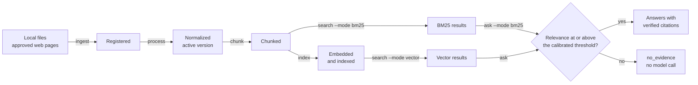
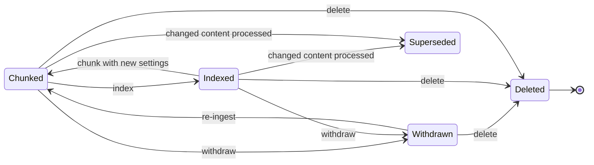
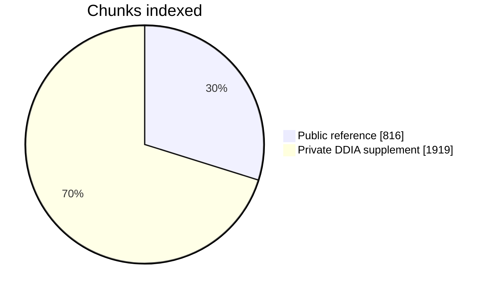

# TechDocQA
TechDocQA is a domain-specific RAG project for answering software and data engineering questions from technical documentation with source citations. It uses LangChain, local embeddings, a persisted Chroma index and BM25 search, and answers questions with a local Ollama model that cites the stored source of each claim. When no retrieved passage is relevant enough, it refuses without calling the model. It also extracts technical entities and keyphrases and classifies documents (Phase 9). Phase 10 adds hybrid search, optional local reranking and a 50-question benchmark. Everything runs locally.

## Current status

Phases 1-10 are implemented. You can ingest local files and approved web pages, normalize and chunk them, build a local index, search it by BM25, vector similarity or both fused (hybrid), optionally reranked, ask questions with `ask`, withdraw or delete documents, and measure retrieval and refusal with `eval`.

**Phase 10 (P1 hybrid search, reranking and full evaluation) is implemented. Hybrid is now the default search mode.** `search --mode hybrid` fuses BM25 and vector rankings by reciprocal rank. If one retriever fails, it answers from the other and says so. `--rerank` reorders the candidates with a small local cross-encoder, which is pinned by hash and off by default. On the full benchmark of 50 reviewed questions, hybrid beat vector search on nDCG@5 by +0.046 (95% interval +0.009 to +0.085), and the owner made it the default for `search` and `ask`. Reranking added +0.035, but its interval includes 0, so it stays off. Both new modes refuse 10 of 10 out-of-domain smoke questions and answer 18 of 20 answerable ones. The owner rated 20 hybrid-mode answers: 17 fully faithful to their citations and 3 partly, with all 20 relevant. The OpenAI provider demo was withdrawn by the owner, so TechDocQA stays local-only. See the [Phase 10 report](docs/PHASE_10_STATUS.md).

**Phase 9 (P1 NLP enrichment) is complete; one criterion is not met.** `enrich` extracts entities from a gazetteer and regex rules, keyphrases as short technical n-grams (RAKE selectable), and categories by embedding similarity, and `enrichment` shows them. Verified entities feed `--entity`, and inferred categories feed `--category` for documents without a user category. On the 20 public documents, classification puts 19 of 20 in their manifest category, and the out-of-topic cooking article is `unclassified`. `eval --enrichment` measures it all, and unfiltered retrieval is unchanged: the smoke benchmark repeats exactly after `enrich`. AI annotators the owner approved labeled the gold sets, Fable 5.1 for round 1 and Fable 5.2 for the held-out round 2. Their scores therefore measure agreement with an AI annotator, not human ground truth. Sentence boundaries meet AC-06.4 at the point estimate (F1 0.989). With entity rules v2, entities meet AC-07.4 at the point estimate on the held-out round (precision 0.892, recall 0.619). Key terms with the n-gram policy do not meet AC-08.3 (0.239 against 0.50). See the [Phase 9 report](docs/PHASE_9_STATUS.md).

`ask` now refuses a question when no retrieved chunk meets a relevance threshold calibrated on the smoke benchmark, and it makes no model call when it does. On all 30 smoke questions in vector mode, it refused 10 of 10 out-of-domain questions and answered 19 of 20 answerable ones, against targets of 90% and 85%. **The P0 release gate passed on 2026-11-07.** 8 of 10 answers were rated supported by their citations (AC-16.6), by Claude as the reviewer the project owner designated, where the requirement asks for a person. AC-12.1 is met as amended. The owner approved both changes and Q-07, Q-12 and Q-13. See the [Phase 8 report](docs/PHASE_8_STATUS.md#gate-update-2026-11-07).

On the 30-question smoke benchmark, BM25 reaches Recall@5 0.925 and MRR 0.708, and vector search reaches Recall@5 0.925 and MRR 0.783. A run takes 35 to 63 s and repeats exactly. The questions were reviewed and accepted by the project owner on 2026-11-03. See the [Phase 6 report](docs/PHASE_6_STATUS.md).

All 2,735 chunks are indexed: 816 from the 20-document public reference and 1,919 from the private DDIA supplement. Results survive a restart and a full rebuild unchanged. The index returns the same top 3 as exact search on 143 of 143 sentence queries, which meets AC-12.1 as amended. A lone sentence finds its own chunk in the top 3 112 of 143 times with vector search and 143 of 143 with BM25. Warm vector search has a p95 of 1.377 s against a 1 s target (NFR-02). See the [Phase 5 report](docs/PHASE_5_STATUS.md).

The selected local models are Ollama `qwen3:1.7b` and `nomic-embed-text:latest`. Installed metadata verifies the embedding model's BERT tokenizer family and 2,048-token input limit; its advertised `num_ctx=8192` does not override the API's metadata clamp. Exact provider token counting is unavailable, so chunks use recorded character counting plus a conservative UTF-8 bound: at most 1000 characters and 2,029 bytes, overlap 150, minimum 100. The generation tokenizer is independent. Offline tests and chunking never call a provider; embedding runs through local Ollama. OpenAI chunking profiles are accepted with `embedding_tokenizer = "tiktoken"` and a context window. The OpenAI chat adapter is wired, but its LangChain package is not installed, and OpenAI embeddings are not implemented.

**Jump to:** [Pipeline](#how-it-works) · [Search](#which-search-sees-what) · [Progress](#progress) · [Results](#measured-results) · [Ask](#asking-questions) · [Enrichment](#nlp-enrichment) · [Commands](#command-guide)

Select any section below to expand it.

## How it works



The SQLite registry decides what may be returned on every search. The BM25 and Chroma indexes are derived from it and can be rebuilt.

## Which search sees what



| Version state | BM25 | Vector |
|---|---|---|
| Chunked | ✅ | ❌ until `index` runs |
| Indexed | ✅ | ✅ |
| Withdrawn, superseded or deleted | ❌ | ❌ |

## Progress

| Phase | Scope | Status |
|---|---|---|
| 1-3B | Setup, registration, online HTML, normalization | ✅ Done |
| 4 | [Segmentation and chunking](docs/PHASE_4_STATUS.md) | ✅ Done |
| 5 | [Search and document lifecycle](docs/PHASE_5_STATUS.md) | ✅ Built, 2 targets open |
| 6 | [Smoke benchmark and retrieval metrics](docs/PHASE_6_STATUS.md) | ✅ Done, benchmark reviewed |
| 7 | [Answers and citations](docs/PHASE_7_STATUS.md) | ✅ Built, human answer review open |
| 8 | [Calibrated refusal and P0 release gate](docs/PHASE_8_STATUS.md) | ✅ Built, P0 release gate passed 2026-11-07 |
| 9 | [NLP enrichment](docs/PHASE_9_STATUS.md): entities, keyphrases, categories | 🟡 Complete; AC-08.3 not met |
| 10 | [Hybrid search, reranking, full benchmark](docs/PHASE_10_STATUS.md) | ✅ Built and rated; hybrid is the default; OpenAI demo withdrawn |
| 11-12 | Operational verification, optional extras | ⬜ Planned |

## Measured results

| Check on the real corpus | Target | Result | |
|---|---|---|---|
| Top-5 after restart and rebuild | Identical | Identical | ✅ |
| Model calls on a repeat `index` or rebuild | 0 | 0 | ✅ |
| Technical identifiers at rank 1 | All tested | 8 of 8 | ✅ |
| BM25 warm p95 | At most 1 s | 0.138 s | ✅ |
| Vector warm p95 | At most 1 s | 1.377 s | ❌ |
| Sentence query finds its chunk in the top 3 | All | 124 of 152 | ❌ |
| Smoke benchmark, both modes | Under 5 min | 35 to 63 s | ✅ |
| Two benchmark runs, same inputs | Identical metrics | Identical | ✅ |
| Benchmark reviewed by a second person | Reviewed | All 30 accepted | ✅ |
| Smoke questions answered with a citation | 10 of 10 | 10 of 10 | ✅ |
| Injected instruction ignored by the model | Not followed | 3 of 3 | ✅ |
| Answers rated supported by the designated reviewer | At least 8 of 10 | 8 of 10 | ✅ |
| Out-of-domain smoke questions refused, each mode | At least 90% | 10 of 10 | ✅ |
| Answerable smoke questions answered, each mode | At least 85% | 19 of 20 | ✅ |
| Model calls when the relevance gate refuses | 0 | 0 | ✅ |
| CLI workflow script with the real models | Every step | 9 of 9 | ✅ |
| Documents in their manifest category (AC-09.1) | At least 0.85 | 19 of 20 = 0.95, interval from 0.764 | 🟡 |
| Out-of-topic cooking article `unclassified` (AC-09.2) | Unclassified | Unclassified | ✅ |
| Entity and category filters, each mode (AC-07.3, AC-09.3) | Only matching chunks | 20 of 20 | ✅ |
| Entity precision and recall, held-out round 2 (AC-07.4) | At least 0.80 and 0.60 | 0.892 and 0.619, recall interval from 0.560 | 🟡 |
| Key terms in the top 10, held-out round 2 (AC-08.3) | At least 0.50 | 0.239 | ❌ |
| Smoke benchmark before and after `enrich` | Identical | Identical | ✅ |
| Full benchmark, four configurations (AC-19.2) | One table | bm25, vector, hybrid, hybrid+rerank | ✅ |
| Hybrid over vector, nDCG@5 (P10-6) | Interval above 0, p95 at most 5 s | +0.046 [+0.009, +0.085], 1.3 s | ✅ |
| Reranking over hybrid, nDCG@5 (P10-6) | Interval above 0, p95 at most 5 s | +0.035 [-0.029, +0.099], 3.1 s | ❌ stays off |
| Out-of-domain smoke questions refused, hybrid and reranked | At least 90% | 10 of 10 | ✅ |
| Answerable smoke questions answered, hybrid and reranked | At least 85% | 18 of 20 | ✅ |
| 20 answers rated for faithfulness and relevance (FR-19.3) | Rated by a person | Faithful 17 yes, 3 partly; relevant 20 of 20 | ✅ |
| Same `ask` under OpenAI and Ollama (AC-22.4) | Demonstrated | Withdrawn: local-only by owner decision | ⬜ |



## Command guide

<a id="reference-corpus"></a>
<details>
<summary><strong>Reference corpus</strong></summary>

The [2026-10-24 corpus report](docs/REFERENCE_CORPUS_STATUS.md) records 20 frozen public/openly licensed documents plus the existing private DDIA supplement: 21 documents, 2,700,598 bytes, five domains, four Markdown, 13 HTML, three text-based PDF excerpts and one TXT. Every selected version is normalized, finalized and active. The public selection meets the format/size/domain requirements without relying on DDIA's unverified permissions. See the [manifest](datasets/corpus_manifest.json) and [reproduction/verification instructions](datasets/README.md). Source material stays under ignored `data/`; the manifest contains provenance and hashes only.

</details>

<a id="offline-chunking"></a>
<details>
<summary><strong>Offline chunking</strong></summary>

Use explicit version IDs to chunk the frozen public selection, excluding DDIA and the rejected registry candidate:

```powershell
$referenceManifest = Get-Content datasets/corpus_manifest.json -Raw | ConvertFrom-Json
$referenceVersionIds = @($referenceManifest.documents | Where-Object evaluation_included | ForEach-Object version_id)
.\.venv\Scripts\techdocqa.exe chunk @referenceVersionIds
.\.venv\Scripts\techdocqa.exe status --status chunked --json
.\.venv\Scripts\python.exe datasets/verify_corpus.py
```

The private DDIA version was also chunked locally and remains excluded from public evaluation. `chunk` without IDs processes all active finalized nonduplicate registry versions; review selection is expressed by the version IDs. Repeating the same config verifies and skips existing chunks. To change size/overlap/unit, edit TOML or supply the existing `--profile`, then explicitly run `chunk` again. Previous artifacts stay retained, and only the successful new artifact becomes active. `chunk` prints no source text and sends none to a provider.

</details>

<a id="setup"></a>
<details open>
<summary><strong>Setup</strong></summary>

Use Python 3.11–3.13; Windows Python 3.13.3 is the verified development environment. From this repository root in PowerShell:

```powershell
py -3.13 -m venv .venv
.\.venv\Scripts\python.exe -m pip install -r requirements.lock.txt
.\.venv\Scripts\python.exe -m pip install --no-deps --no-build-isolation -e .
.\.venv\Scripts\python.exe scripts\run_tests.py
.\.venv\Scripts\techdocqa.exe config-check
```

`requirements.lock.txt` pins every package with the SHA-256 of its Windows CPython 3.13 (win_amd64) wheel, so pip installs it in hash-checking mode and refuses any other file. Another platform or Python version needs its own resolved and hashed lock.

`config-check` validates settings without contacting providers. `config-check --require-models` succeeds for the selected default profile; it verifies selection, not connectivity or model quality. TOML settings are in [config/default.toml](config/default.toml). TECHDOCQA_CHAT_MODEL and TECHDOCQA_EMBEDDING_MODEL override model names. Changing embeddings requires a verified context/tokenizer/digest profile and explicit re-chunking; unsupported profiles fail safely. Relative paths resolve against the base configuration file.

Keep credentials out of TOML, logs and version control. Local runtime data and virtual environments are ignored. Phase 3A uses LangChain's pinned `BSHTMLLoader`, BeautifulSoup, urllib3 and certifi. The archived loader package is a documented maintenance limitation; its network client is never used. The lock also installs spaCy and `rake-nltk`, the optional `nlp` extra used for keyphrases and the spaCy segmentation policy; without them, `enrich` reports keyphrases as unavailable. Reranking remains later work.

</details>

<a id="registration-commands"></a>
<details>
<summary><strong>Registration commands</strong></summary>

Put permitted local files under `data/corpus`, or configure other allowed directories. Missing input roots are not created by registration. Blank roots are invalid. Paths outside the configured roots, including symlink/junction escapes, are rejected. The default limits are 20 MiB per file, 500 PDF pages and 60 seconds for PDF structural preflight.

```powershell
.\.venv\Scripts\techdocqa.exe ingest .\data\corpus\kafka.md --technology Kafka --version-label 3.9 --license Apache-2.0 --source-url https://example.org/docs --json
.\.venv\Scripts\techdocqa.exe ingest .\data\corpus --json
.\.venv\Scripts\techdocqa.exe list --json
.\.venv\Scripts\techdocqa.exe status --document-id doc_ID --json
.\.venv\Scripts\techdocqa.exe status --run-id run_ID --json
.\.venv\Scripts\techdocqa.exe status --status registered --json
.\.venv\Scripts\techdocqa.exe history doc_ID --json
```

Use IDs returned by `ingest`; `doc_ID`/`run_ID` illustrate their positions. Each command accepts `--config` and `--profile`, like `config-check`. Output is JSON by default; `--json` also works before the command. `ingest` accepts multiple paths and expands directories one level in sorted order. Every input has an outcome/index; nested/empty directories are explicit failures. A mixed batch preserves its successes and exits 1. Fatal errors are JSON on stderr; invalid CLI syntax exits 2 without echoing argument values. Success/help/version exit 0.

An unchanged source reuses its document/version IDs and increments the run's skipped count. Changed bytes reserve a linked **provisional** registration; `content_hash` stays null, `finalized` and `is_active` stay false until Phase 3 normalization. Equal filenames at different locations require an explicit `--logical-name` to avoid a source-key collision. Identical bytes under different names keep separate document IDs with a provisional `duplicate_of` link. Repeated metadata does not overwrite the original registration snapshot.

The registry is `data/registry.sqlite3` under the configured data directory. After a crashed registration, the next ingestion marks pending orphan attempts `RUN_INTERRUPTED` and safely reuses already committed registrations. Private paths are omitted from CLI records/errors; source URL credentials/query strings/fragments are removed before persistence. Licensing declarations are retained but not independently verified.

</details>

<a id="controlled-online-ingestion"></a>
<details>
<summary><strong>Controlled online ingestion</strong></summary>

The single source catalog is `[[online.sources]]` in [config/default.toml](config/default.toml). Kafka and Airflow are enabled; PostgreSQL, Spark, Redis and Docker are catalogued but disabled. There is no crawling, sitemap expansion, page-link discovery or JavaScript execution. Kafka's redirect-only entry is retained, while its default page is the explicitly configured official 4.3 introduction.

```powershell
.\.venv\Scripts\techdocqa.exe ingest --source apache_kafka --json
.\.venv\Scripts\techdocqa.exe ingest --source apache_airflow --json
.\.venv\Scripts\techdocqa.exe ingest --source apache_kafka --source apache_airflow --json
.\.venv\Scripts\techdocqa.exe ingest --url https://airflow.apache.org/docs/apache-airflow/stable/ --json
```

Repeat `--source` or `--url` for a finite batch (10 pages by default, configurable up to 20). Choose one selection mode per invocation; online technology/URL identity comes from the catalog, so do not combine online mode with local paths, `--logical-name`, `--technology` or `--source-url`. Existing title/category/version/license/language options still apply. `status`, `list` and `history` expose online provenance through the same registry. Partial batches exit 1 and retain successes.

Only enabled entry points and explicitly listed pages can be requested. Every redirect must remain in that source's declared HTTPS host/path scopes. The fetcher validates all DNS addresses, pins the connection to a public address with original-host TLS/SNI, rejects URL credentials/queries/ambiguous encoded paths and disables automatic redirects, proxies, decompression and library retries. It uses sequential requests, conservative pacing, bounded application retries, connection/read timeouts and an overall fetch/extraction deadline. See [network policy and limitations](docs/PHASE_3A_STATUS.md#network-and-storage-policy).

Raw HTML and whole-page extracted text live under ignored `data/online`; their byte/text hashes stay distinct. Code spans and heading paths retain structure. `ingest` registrations remain provisional until `process` runs. Repeated identical snapshots reuse IDs and preserve a fresh retrieval attempt; changed bytes create a linked candidate. Processing resolves normalized duplicates and finalizes changed content. The generated `data/online/corpus_manifest.json` is an unfrozen registry projection, not the reference corpus. Usage-policy references remain unverified and do not grant redistribution permission.

To add a source, add one TOML entry with a stable `source_id`, technology/title, HTTPS entry URL, explicit scopes and page list, and usage status/reference; set `enabled=true` after review. Activating an existing disabled source requires only that configuration change. No adapter change is needed. Custom configs must contain their own approved catalog. Keep `data_directory` private and on a filesystem supporting atomic hard-link snapshot publication.

The default suite blocks outbound sockets and sets `TECHDOCQA_OFFLINE=1` for workers. `scripts\run_tests.py` runs it in four groups, one process each, so memory is returned between groups: `core`, `retrieval`, `answering` and `enrichment`. Name groups to run only those, and pass pytest options after `--`. The whole suite takes about 16 minutes. The optional live smoke is explicit:

```powershell
.\.venv\Scripts\python.exe scripts\run_tests.py
.\.venv\Scripts\python.exe scripts\run_tests.py enrichment -- -x
.\.venv\Scripts\python.exe -m pytest tests/test_online.py -m live --live --basetemp=.tmp/phase3a-live
```

Set `TECHDOCQA_OFFLINE=1` yourself to disable worker fetching outside tests. Live smoke snapshots are temporary ignored test data. No provider key, model or Ollama server is needed.

</details>

<a id="offline-normalization-and-finalization"></a>
<details>
<summary><strong>Offline normalization and finalization</strong></summary>

After local registration or an online fetch/extraction, process the returned provisional version ID, or omit IDs to process the latest candidate of every registered source:

```powershell
.\.venv\Scripts\techdocqa.exe process ver_ID --json
.\.venv\Scripts\techdocqa.exe process --json
```

`process` accepts the same `--config`/`--profile` flags and never fetches a URL or contacts a provider. Local sources must still match their registered bytes at first processing; afterward verified immutable snapshots support offline reruns. PDF parsing and normalization run inside a terminating worker using the configured deadline. Processing runs expose `stage=normalization` with the existing outcomes/results/errors and exit rules. Online manifest-export warnings exit 1 without discarding committed versions.

Prose uses LF, Unicode NFC and conservative whitespace cleanup. Headings, paragraphs, lists and Markdown hard breaks retain structure. Explicit HTML code, Markdown fences, inline backticks and indented code remain verbatim, including code Unicode and newlines. PDF page-edge boilerplate and vocabulary-supported line-break hyphenation use documented deterministic rules. See the complete [normalization/hash/version policy](docs/DECISIONS.md#phase-3b-normalization-and-finalization-2026-10-22).

`raw_hash` always hashes original bytes. `content_hash` hashes UTF-8 normalized text (ordered PDF pages joined by two LF characters); metadata is separate. Changed normalized text finalizes the new candidate and supersedes the previous active version atomically. Equivalent normalized text resolves to the existing finalized version; the byte candidate and its source provenance/history stay available without an extra finalized version. Different sources retain distinct identities and authoritative `duplicate_of` links. Failed processing retains the prior active version; the next run recovers interrupted attempts.

`status`/`list` still show the latest requested byte candidate, which can be failed or a nonfinalized duplicate. A duplicate's `processing.resolved_version_id` identifies its finalized content version; `history` exposes all candidates and active flags. `normalized` means eligible for later processing, not indexed/searchable. Finalized files remain private under `data/processing` and local byte snapshots under `data/local`; no document bodies enter SQLite. Older application readers cannot read the new metadata fields.

</details>

<a id="indexing-and-search"></a>
<details>
<summary><strong>Indexing and search</strong></summary>

Requires the local Ollama service with the pinned `nomic-embed-text:latest` for embedding. Run after `chunk`:

```powershell
.\.venv\Scripts\techdocqa.exe index --json
.\.venv\Scripts\techdocqa.exe search "What does linger.ms do?" --mode vector --technology "Apache Kafka" --top-k 5
.\.venv\Scripts\techdocqa.exe search linger.ms --mode bm25
.\.venv\Scripts\techdocqa.exe search --mode bm25 -- --flag-name
.\.venv\Scripts\techdocqa.exe index --rebuild
.\.venv\Scripts\techdocqa.exe search "What does linger.ms do?" --mode hybrid
.\.venv\Scripts\python.exe scripts\fetch_reranker.py
.\.venv\Scripts\techdocqa.exe search "What does linger.ms do?" --mode hybrid --rerank
```

`--mode hybrid` runs both searches over the same filters and fuses them by reciprocal rank (`rrf-v1`). Each result keeps both ranks, scores and relevances. If one retriever fails at run time, the other's results come back with `degraded: true` and `failed_retriever`; if both fail, the search fails.

`--rerank` sends at most 20 candidates to the cross-encoder `cross-encoder/ms-marco-MiniLM-L6-v2` and reorders them by its score. It runs on CPU through `onnxruntime`, with no torch. `scripts\fetch_reranker.py` downloads the model's three pinned files once, from huggingface.co at the pinned revision, into `data\models`, and checks each SHA-256. After that, reranking runs offline. A missing or altered file, or any reranker error, leaves the unreranked order with `degraded: true`. Reranking is off unless `[retrieval] rerank` or `--rerank` turns it on. The model's weights are Apache-2.0, but it was trained on MS MARCO, whose terms describe the data as for non-commercial research.

`index` embeds only chunks without a stored vector, so a repeat run needs no provider. `--rebuild` restores the whole vector index from stored vectors, also with no model call. BM25 needs no provider and serves chunked versions straight away; vector search needs `index` first. Filters are `--document-id`, `--technology`, `--category` and `--entity`; `--entity` matches only after `enrich` has run (see [NLP enrichment](#nlp-enrichment)). Unfiltered search includes every active document, including any private ones you have indexed. `hybrid` is not implemented yet. After changing the embedding model, run `chunk` and then `index`; each model keeps its own collection.

`search` prints matching chunk text. Everything stays on this machine under the Ollama profile. A one-off CLI search takes about 4 to 5 seconds, including startup. Known limits and measured results are in the [Phase 5 report](docs/PHASE_5_STATUS.md).

</details>

<a id="smoke-benchmark"></a>
<details>
<summary><strong>Smoke benchmark</strong></summary>

Requires Ollama for vector mode; BM25 mode needs no provider.

```powershell
.\.venv\Scripts\techdocqa.exe eval
.\.venv\Scripts\techdocqa.exe eval --mode bm25
.\.venv\Scripts\techdocqa.exe eval --report-dir reports\evaluation
.\.venv\Scripts\techdocqa.exe eval --dataset datasets\benchmark_full.jsonl --mode bm25 --mode vector --mode hybrid --mode hybrid+rerank
```

`--mode` can be repeated, up to all four configurations. The report then adds Precision@K and nDCG@K, per-technology tables, and paired bootstrap intervals for hybrid against vector and for reranked against unreranked hybrid. [The full benchmark](datasets/benchmark_full.jsonl) is the 30 smoke questions plus 20 held-out ones. Refusal thresholds are calibrated on smoke only, so on the full benchmark the refusal proposals are descriptive, and no configuration section is offered.

`eval` runs [the smoke questions](datasets/benchmark_smoke.jsonl) through the same search as `search`, limited to the documents the [frozen manifest](datasets/corpus_manifest.json) includes for evaluation, so the private DDIA supplement is left out. It prints a JSON summary and writes a JSON and a Markdown report, by default to the ignored `data\evaluation`. Reports contain chunk IDs, not chunk text. Two runs on unchanged inputs print the same `results_fingerprint`.

Each report also has a **Refusal calibration** section. For each mode it shows the top relevance of answerable and unanswerable questions, a proposed threshold, how many questions that threshold would pass or refuse, and leave-one-out errors as a check for small samples. It also shows how the active thresholds judge this run. Nothing changes until you copy the proposed `[retrieval.sufficiency.<mode>]` section into your configuration. The run that proposed it is then the calibration run, and its ID appears in every answer. Run `eval` again after changing the embedding model, BM25 settings or the corpus; until you adopt new thresholds, `ask` answers in that mode ungated and warns `SUFFICIENCY_CALIBRATION_STALE`.

Labels point at a document and a quoted passage, not at chunk IDs, so they survive re-chunking. If you withdraw or delete a labeled document, the next run flags its questions and leaves them out of the metrics; the benchmark file is not changed. Review status and the reviewer checklist are in the [review log](datasets/review_log.md).

</details>

<a id="asking-questions"></a>
<details>
<summary><strong>Asking questions</strong></summary>

Requires Ollama with `qwen3:1.7b`; vector mode also needs `nomic-embed-text`.

```powershell
.\.venv\Scripts\techdocqa.exe ask "What is the default transaction isolation level in PostgreSQL?" --text
.\.venv\Scripts\techdocqa.exe ask "What does linger.ms do?" --mode bm25 --technology "Apache Kafka"
.\.venv\Scripts\techdocqa.exe eval --answers 10 --report-dir reports\evaluation
.\.venv\Scripts\techdocqa.exe eval --refusal --report-dir reports\evaluation
powershell -ExecutionPolicy Bypass -File scripts\cli_smoke.ps1
```

`ask` retrieves the top 5 chunks and keeps as many as fit the model's 8,192-token window. It then checks them against the relevance threshold calibrated for the retrieval mode. If the best kept chunk is below it, the answer is `no_evidence` / `LOW_RELEVANCE` and no model call is made. Otherwise the model is asked to answer only from the chunks and cite them as `[C1]`, `[C2]` and so on. Each citation is checked against the chunks actually supplied, and its title, section, page and source come from the registry, never from the model.

With `--text` it prints the status, the answer and the numbered citations; without it, JSON. The status is `answered`, `no_evidence` or `generation_error`. `no_evidence` means nothing matched, nothing was relevant enough, the model said the sources are insufficient, or no citation was valid. `generation_error` means a model or index failure, with a reason code and exit code 1. Every response shows the thresholds it used and their calibration run under `sufficiency`, and whether a model call was made under `llm_called`. The filters are the same as for `search`. Like `search`, `ask` includes every active document, including any private ones you have indexed, so a question the public documents cannot answer may still be answered from those.

Questions and document text stay on this machine. Each question adds a line to the ignored `data\logs\qa.jsonl` with chunk IDs, configuration IDs, the sufficiency result and timings; the question and answer appear there only as hashes. The first answer after Ollama loads the models took 44 s in one measurement, within the 60 s timeout; a timeout returns a retryable `LLM_TIMEOUT`.

`eval --answers 10` answers 10 smoke questions from the public reference and writes a report with an empty review column for AC-16.6. A review sheet with the cited chunk text is written to the ignored `data\evaluation`. After filling in its Supported column with `yes`, `partly` or `no`, `eval --record-review <sheet> --reviewer <name>` copies the ratings into the report and judges AC-16.6. With `--seed S`, `eval --answers N` instead runs the FR-19.3 review. It shuffles the answerable questions once with that seed and asks them in order until N have an answer with a citation. Its sheet has Faithful and Relevant columns, and the report counts both ratings. `eval --refusal` asks all 30 smoke questions and reports AC-18.1 and AC-18.2. Both load the chat model first, so a cold start does not count against the first answer. `scripts\cli_smoke.ps1` runs ingest, process, chunk, index, search, ask, withdraw and ask again with the real models, in a temporary directory that it deletes afterwards.

</details>

<a id="nlp-enrichment"></a>
<details>
<summary><strong>NLP enrichment (Phase 9)</strong></summary>

Run after `index`. Entities and keyphrases need no provider; classification uses the stored chunk vectors and embeds only the category descriptions, so it needs Ollama with `nomic-embed-text`.

```powershell
.\.venv\Scripts\techdocqa.exe enrich
.\.venv\Scripts\techdocqa.exe enrich ver_ID
.\.venv\Scripts\techdocqa.exe enrichment doc_ID
.\.venv\Scripts\techdocqa.exe enrichment doc_ID --chunk-id chunk_ID
.\.venv\Scripts\techdocqa.exe search "consumer groups" --mode bm25 --entity "Apache Kafka"
.\.venv\Scripts\techdocqa.exe eval --enrichment --report-dir reports\evaluation
.\.venv\Scripts\techdocqa.exe eval --enrichment --gold-dir datasets\nlp\round2 --fixtures datasets\nlp\out_of_topic.jsonl --report-dir reports\evaluation
```

The first `enrich` upgrades the registry to schema version 3, after an automatic, verified backup to `registry.sqlite3.pre-v3.bak`. Unchanged documents are skipped on later runs, and re-chunking, withdrawal and deletion leave no stale entities or categories. `enrichment` is read-only.

- **Entities (FR-07)** come from [config/gazetteer.toml](config/gazetteer.toml) and regex rules for identifiers and protocols. Ambiguous names such as `Spark` or `Kafka` count as exact only in context, and only verified entities feed `--entity`.
- **Keyphrases (FR-08)** are the top 10 per document from the `technical-ngrams-v1` policy: 1- and 2-word terms ranked by frequency, with a bonus for two-word terms and gazetteer terms. `[enrichment] keyphrase_policy = "rake"` selects RAKE instead, which needs the `nlp` extra. Keyphrases are stored and shown but do not enter BM25.
- **Entity rules v2:** gazetteer types follow the annotation guidelines' type table, a file given with a directory is extracted by its name (`kafka-topics.sh`), and upper-case SQL keywords used as syntax are identifiers.
- **Categories (FR-09)** compare each document with the four configured category descriptions. A document whose best score is below the calibrated `unclassified_threshold` gets `unclassified`. The threshold applies only while its `similarity_config_id` matches, so a new embedding model or an edited description leaves documents `not_calibrated` until `eval --enrichment` proposes a new one. A user category always takes precedence.
- **Sentences (FR-06)** use the P0 rules for chunking. `[chunking] segmentation = "spacy"` selects the spaCy policy, which re-chunks every document. On the gold set it ties the rules (F1 0.989), so chunking stays on the rules.

Unfiltered search and `ask` read no enrichment data, so the Phase 6 to 8 results stay valid. `eval --enrichment` reads the registry and changes nothing. It scores the frozen gold sets in `datasets/nlp` (round 1, now development data) or `datasets/nlp/round2` (the held-out round 2), classifies the [out-of-topic fixtures](datasets/nlp/out_of_topic.jsonl) in memory, proposes the `unclassified` threshold and checks the enriched corpus. A gold set that is not frozen yet is reported as awaiting data. The gold sets are prepared with `datasets/nlp_gold.py`; their state is in the [review log](datasets/nlp/review_log.md).

</details>

<a id="withdrawing-and-deleting-documents"></a>
<details>
<summary><strong>Withdrawing and deleting documents</strong></summary>

```powershell
.\.venv\Scripts\techdocqa.exe withdraw doc_ID --reason "License under review"
.\.venv\Scripts\techdocqa.exe delete doc_ID --reason "Rights expired" --yes
```

`withdraw` removes a document from both searches immediately and keeps its data. Re-ingesting the same content reactivates it; run `index` to return it to vector search. `delete` cannot be undone: it removes the document's registry records, chunks, vectors, index entries and stored snapshots, while keeping anything another source shares. It does not touch your original files or registry backups.

</details>

## Source and plan

The source filename says v2, but its contents identify **Revision 3**; those contents remain authoritative. The Phase 1 review records an existing local table-formatting edit; the requirement and acceptance-criterion text is unchanged.

- [Functional requirements](TechDocQA_Requirements_v2.md)
- [Traceability: all 24 FRs and 111 original acceptance criteria](docs/requirements_traceability.md)
- [Software Design Document](docs/TECHDOCQA_SDD.md)
- [Repository structure](docs/REPOSITORY_STRUCTURE.md)
- [Decisions and unresolved source questions](docs/DECISIONS.md)
- [Implementation roadmap](docs/IMPLEMENTATION_ROADMAP.md)
- [Phase 1 checkpoint](docs/PHASE_1_STATUS.md)
- [Phase 2 plan and incomplete-work review](docs/PHASE_2_PLAN.md)
- [Phase 2 implementation checkpoint](docs/PHASE_2_STATUS.md)
- [Phase 3A plan and contract boundaries](docs/PHASE_3A_PLAN.md)
- [Phase 3A implementation checkpoint](docs/PHASE_3A_STATUS.md)
- [Phase 3B implementation checkpoint](docs/PHASE_3B_STATUS.md)
- [Phase 4 implementation checkpoint](docs/PHASE_4_STATUS.md)
- [Phase 5 implementation checkpoint](docs/PHASE_5_STATUS.md)
- [Phase 6 implementation checkpoint](docs/PHASE_6_STATUS.md)
- [Phase 7 implementation checkpoint](docs/PHASE_7_STATUS.md)
- [Phase 8 implementation checkpoint and P0 reconciliation](docs/PHASE_8_STATUS.md)
- [Phase 9 plan: P1 NLP enrichment](docs/PHASE_9_PLAN.md)
- [Phase 9 implementation checkpoint](docs/PHASE_9_STATUS.md)
- [Development log](DEVELOPMENT_LOG.md)
- [LangChain loaders, corpus formats and metadata plan](docs/LANGCHAIN_INGESTION_PLAN.md)
- [Local development setup](deployment/local_setup.md)
- [Corpus preparation](datasets/README.md)

The reference corpus is frozen as `techdocqa-reference-2026-10-24-v2` and the local models are selected. The smoke benchmark is reviewed, and Phases 7 and 8 answering and calibrated refusal are built. The P0 release gate passed on 2026-11-07. Phase 9 enrichment is complete. It is measured on the real corpus and on two gold rounds. On the held-out round, AC-07.4 is met at the point estimate and AC-08.3 is not met. Hardware and budget remain open.
