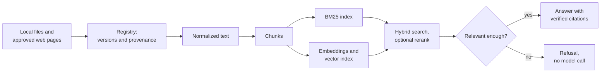

# TechDocQA

TechDocQA answers software and data engineering questions from technical documentation, citing the source of each claim. It is a retrieval-augmented generation (RAG) system that runs entirely on one machine, so documents, questions and answers never leave it. When no retrieved passage is relevant enough to answer from, it says so instead of guessing, and it doesn't call the model.

## What it does

- **Ingests documentation** from local Markdown, text, HTML and PDF files, and from selected pages of official documentation sites listed in an approved catalog.
- **Tracks every document version.** Content hashes detect duplicates and changes, and each version keeps its source, title, sections and pages.
- **Splits documents into chunks** along sentence and section boundaries, avoiding splits inside code blocks.
- **Searches three ways:** BM25 keyword search, vector similarity, or a hybrid of the two fused by reciprocal rank. A local cross-encoder can rerank the results.
- **Answers questions with citations.** A local language model answers only from the retrieved chunks, and each citation is checked against them. A calibrated relevance threshold refuses questions the documents don't cover.
- **Enriches the text** with entities, keyphrases and categories, which can also filter a search.
- **Withdraws or deletes documents.** A withdrawn document leaves search at once. A deleted one is removed with all its chunks, embeddings and index entries.
- **Measures itself** against reviewed benchmark questions, for retrieval quality and for answers and refusals.

## How it works

A SQLite registry records every document, version and run, and it decides what each search may return. The BM25 and vector indexes are derived from it, and they can be rebuilt without calling a model.

## Built with

| Part | Choice |
|---|---|
| Language | Python 3.13 |
| Framework | LangChain |
| Language model | `qwen3:1.7b` on Ollama, local |
| Embeddings | `nomic-embed-text` on Ollama, local |
| Vector index | Chroma, stored on disk |
| Keyword search | BM25 |
| Reranker | `cross-encoder/ms-marco-MiniLM-L6-v2` on ONNX Runtime |
| Registry | SQLite |

## Design principles

- **Local only.** No hosted API is used; every model runs on the same machine.
- **Every answer can be traced.** A citation names the document, section, page and version it came from.
- **Documents and questions are untrusted input.**
  - Files must be inside the allowed folders, and their size and page counts are limited.
  - Web fetches are limited to approved pages and refuse local and cloud-metadata addresses.
  - Logs hold no secrets and no document text.
- **Results are reproducible.** Dependencies are pinned by hash and models by digest, and a repeated search returns the same results.

## Reference corpus

A frozen set of 20 public, openly licensed documents about Apache Airflow, Apache Kafka, Apache Spark and PostgreSQL, in Markdown, HTML, PDF and plain text.

## Project history

The plan and report for every development phase are in [docs/PHASES.md](docs/PHASES.md).
