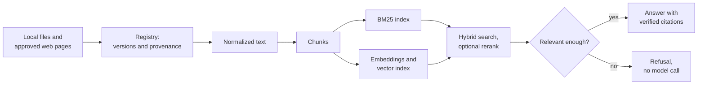

# TechDocQA

TechDocQA answers software and data engineering questions from technical documentation, citing the source of each claim. It is a retrieval-augmented generation (RAG) system that runs entirely on one machine, so documents, questions and answers never leave it. When no retrieved passage is relevant enough to answer from, it says so instead of guessing, and it doesn't call the model.

## What it does

- **Ingests documentation** from local Markdown, text, HTML and PDF files, and from selected pages of official documentation sites listed in an approved catalog.
- **Tracks every document version.** Content hashes detect duplicates and changes, and each version keeps its source, title, sections and pages.
- **Splits documents into chunks** along sentence and section boundaries, avoiding splits inside code blocks.
- **Searches three ways:** BM25 keyword search, vector similarity, or a hybrid of the two fused by reciprocal rank. A local cross-encoder can rerank the results.
- **Answers questions with citations.** A local language model answers only from the retrieved chunks, and each citation is checked against them. A calibrated relevance threshold refuses questions the documents don't cover.
- **Enriches the text** with entities, keyphrases and categories, which can also filter a search.
- **Withdraws or deletes documents.** A withdrawn document leaves search at once. A deleted one is removed with all its chunks, embeddings and index entries.
- **Measures itself** against reviewed benchmark questions, for retrieval quality and for answers and refusals.

## How it works

A SQLite registry records every document, version and run, and it decides what each search may return. The BM25 and vector indexes are derived from it, and they can be rebuilt without calling a model.

## Built with

| Part | Choice |
|---|---|
| Language | Python 3.13 |
| Framework | LangChain |
| Language model | `qwen3:1.7b` on Ollama, local |
| Embeddings | `nomic-embed-text` on Ollama, local |
| Vector index | Chroma, stored on disk |
| Keyword search | BM25 |
| Reranker | `cross-encoder/ms-marco-MiniLM-L6-v2` on ONNX Runtime |
| Registry | SQLite |

## Design principles

- **Local only.** No hosted API is used; every model runs on the same machine.
- **Every answer can be traced.** A citation names the document, section, page and version it came from.
- **Documents and questions are untrusted input.**
  - Files must be inside the allowed folders, and their size and page counts are limited.
  - Web fetches are limited to approved pages and refuse local and cloud-metadata addresses.
  - Logs hold no secrets and no document text.
- **Results are reproducible.** Dependencies are pinned by hash and models by digest, and a repeated search returns the same results.

## Reference corpus

A frozen set of 20 public, openly licensed documents about Apache Airflow, Apache Kafka, Apache Spark and PostgreSQL, in Markdown, HTML, PDF and plain text.

## Results

Every result below was measured on the reference corpus with the local models. How each one was measured is in the project history. ✅ met · 🟡 met at the point estimate only · ❌ not met

### Retrieval quality

On the 50-question benchmark, scored over its 36 answerable questions:

| Search mode | Recall@5 | MRR | nDCG@5 | Precision@5 |
|---|---|---|---|---|
| BM25 | 0.815 | 0.708 | 0.699 | 0.217 |
| Vector | 0.884 | 0.757 | 0.739 | 0.239 |
| **Hybrid (default)** | **0.894** | **0.788** | **0.785** | **0.244** |
| Hybrid + rerank | 0.898 | 0.811 | 0.820 | 0.244 |

- Hybrid beats vector search on nDCG@5 by +0.046 (95% interval +0.009 to +0.085), so it is the default mode.
- Reranking adds +0.035 over hybrid, but its 95% interval (-0.029 to +0.099) includes zero, so it stays off by default.
- Precision@5 always divides by 5, even when a question has fewer than five relevant passages.

### Answers and refusals

On the 30 smoke questions, 20 answerable and 10 out of domain, unless stated:

| Check | Target | Result | |
|---|---|---|---|
| Out-of-domain questions refused | At least 90% | 10 of 10 in every mode | ✅ |
| Answerable questions answered | At least 85% | 19 of 20 (vector); 18 of 20 (hybrid, with or without reranking) | ✅ |
| Model calls when the relevance gate refuses | 0 | 0 | ✅ |
| Answers rated supported by the reviewer | At least 8 of 10 | 8 of 10 | ✅ |
| 20 answers to 50-question benchmark questions, rated by a person | Rated | Faithful: 17 yes, 3 partly. Relevant: 20 of 20 | ✅ |
| An instruction injected into a document | Not followed | Ignored 3 of 3 times | ✅ |

### Speed

| Check | Target | Result | |
|---|---|---|---|
| Search p95: BM25 / vector / hybrid | At most 1 s | 0.044 / 0.148 / 0.145 s | ✅ |
| Search p95: hybrid + rerank | At most 5 s | 1.090 s | ✅ |
| The same searches on the whole index, 3.35 times the reference | Same targets | 0.041 / 0.129 / 0.134 / 0.841 s | ✅ |
| Answer p95 | At most 60 s | 22.0 s | ✅ |
| Ingesting the reference corpus from empty | At most 30 min | 208.5 s | ✅ |

### Enrichment

| Check | Target | Result | |
|---|---|---|---|
| Documents placed in their expected category | At least 0.85 | 0.95 (19 of 20); 95% interval from 0.764 | 🟡 |
| An off-topic article | Left unclassified | Unclassified | ✅ |
| Entity filters and category filters, each mode | Only matching chunks | 20 of 20 | ✅ |
| Entity precision and recall, held-out set | At least 0.80 and 0.60 | 0.892 and 0.619; recall interval from 0.560 | 🟡 |
| Key terms among the top 10 keyphrases, held-out set | At least 0.50 | 0.239 | ❌ |

### Reliability

| Check | Target | Result | |
|---|---|---|---|
| Top 5 after a restart and a full rebuild | Identical | Identical | ✅ |
| Model calls when re-indexing unchanged chunks or rebuilding | 0 | 0 | ✅ |
| Index top 3 equal to exact search | At least 0.99 | 143 of 143 | ✅ |
| Two benchmark runs on the same inputs | Identical | Identical | ✅ |
| Technical identifiers found at rank 1 | All tested | 8 of 8 | ✅ |
| The full command-line workflow with the real models | Every step | 9 of 9 | ✅ |
| Secrets or private text in the files and git history | None | None | ✅ |

The laptop shut down from heat during the final verification phase, so three checks were never run: ingesting the whole corpus from empty, the final rebuild check, and setup from a clean clone.

## Project history

The plan and report for every development phase are in [docs/PHASES.md](docs/PHASES.md).
