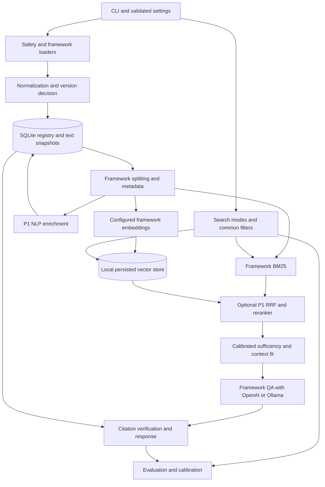

# TechDocQA Software Design Document

Status: proposed, 2026-10-09. Primary source: [TechDocQA_Requirements_v2.md](../TechDocQA_Requirements_v2.md), whose contents identify **Revision 3**. [Traceability](requirements_traceability.md) preserves all original FR titles, priorities, dependencies and acceptance criteria. [Decisions](DECISIONS.md) distinguishes engineering proposals and unresolved questions from source requirements. No implementation or measured performance is claimed.

Current checkpoint, 2026-10-21: Phase 2 local registration is preserved. [Phase 3A](PHASE_3A_STATUS.md) adds approved finite online HTML fetches, isolated LangChain extraction, content-addressed snapshots and URL/retrieval provenance through the existing registry. [Phase 2 contracts](DECISIONS.md#implemented-phase-2-contracts-2026-10-21) still govern local keys and provisional eligibility; [online contracts](DECISIONS.md#phase-3a-online-contracts-2026-10-21) document the additive JSON/API extension without a SQL migration. Local framework parsing, normalization/finalized versioning, splitting/indexing/retrieval/QA/evaluation remain future work; models remain deferred.

## 1. Overview and scope

TechDocQA answers English software/data engineering questions from a small, frozen technical-document corpus with source citations and refusal when evidence is inadequate. The deliverable is a portfolio/course-quality Python CLI application, developed incrementally under an approved plan. LangChain is proposed; OpenAI and Ollama are configuration-selected providers.

In scope: local PDF/HTML/Markdown/TXT ingestion, normalization, provenance, chunking, embeddings, independent BM25/vector search, grounded QA, evaluation, withdrawal/deletion and local safety. P1 adds full NLP, hybrid RRF, optional reranking and full evaluation/provider switching. P2 URL ingestion, web UI, cross-version embedding reuse and FR-24 remain optional. OCR, multilingual support, multi-turn chat, authentication, fine-tuning, table/image understanding, web-scale/high-availability infrastructure and version restoration remain out of scope per source section 1.4.

## 2. Requirements and constraints

All FR-01 through FR-24 are mapped in section 17; original pass/fail criteria are in traceability. Priority slices remain P0/P1/P2 exactly as source section 3 and individual headings specify. FR-15 is P1 work with runtime reranking disabled by default; it is not dropped from full evaluation.

| Constraint | Design obligation |
|---|---|
| C-01 | Use chosen framework for loading, splitting, embedding, vector storage, retrieval and QA. Pin framework version. |
| C-02 | OpenAI/Ollama generation settings; environment keys. |
| C-03 | Configurable permitted embedding families, model identity recorded. |
| C-04 | Local file/in-process storage, no required hosted DB or cluster. |
| C-05 | Enforce small reference corpus scope. |
| C-06 | Report measured/estimated ingestion + full benchmark API cost or required local hardware. |
| C-07 | Configuration-only provider switching; embedding changes rebuild index. |
| DS-01 | 15–30 documents, <=50 MB, target about <=3000 chunks. |
| DS-02 | 3–5 technologies. |
| DS-03 | At least 3 Markdown, 3 HTML, 3 text PDFs and 1 TXT. |
| DS-04 | Public/open documentation manifest with source, license/terms and content hash; frozen evaluation corpus. |
| DS-05 | Separate synthetic duplicate, modified, renamed, image PDF, unsupported and Latin-1 fixtures. |
| DS-06 | 30–50 benchmark questions; smoke subset preserved. |

| NFR | Original target / verification plan |
|---|---|
| NFR-01 | Reference scale with 2x headroom; separately test headroom without enlarging frozen reference corpus. |
| NFR-02 | Retrieval p95 <=1 s without reranking, <=5 s with it; measure all modes on documented machine. |
| NFR-03 | QA p95 <=15 s OpenAI, <=60 s Ollama CPU; report retrieval/generation separately. |
| NFR-04 | Corpus ingestion <=15 min hosted embeddings, <=30 min local; measure chosen profiles. |
| NFR-05 | Pin framework/model/tokenizer/libraries/configuration; commit exact lock and record runs. |
| NFR-06 | Identical retrieval with identical inputs, chunk_id tie-break; low-temperature generation may vary. |
| NFR-07 | Clean-machine README with virtualenv/pip and optional ollama pull. |
| NFR-08 | Document external data transmission with OpenAI; support fully local Ollama mode. |
| NFR-09 | Document full-ingestion/full-benchmark expected API cost and approved budget. |
| NFR-10 | Automated AC tests where practical; offline model mocks plus clearly identified real/human gates. |
| NFR-11 | Separate replaceable components using framework abstractions. |

NFR targets are initial source values pending reference-machine measurement. No default is weakened here. Budget, hardware, exact models and corpus remain unset.

## 3. Proposed architecture

One Python package and CLI coordinate local components. SQLite is authoritative for document state and provenance; persisted Chroma and an in-memory BM25 index are derived views. Framework objects perform model/retrieval orchestration. No API service is required.

Eligibility is checked against registry state on every retrieval and citation resolution, preventing stale vector/BM25 snapshots from returning superseded/withdrawn data. Cross-store failure recovery is local reconciliation, not a promise of distributed transactions.

## 4. Components and interfaces

Use source section 8 as the typed response baseline, implemented later with Pydantic models/type hints. Original examples contain comments and are illustrative, not strict JSON fixtures.

| Component | Inputs -> outputs / responsibility |
|---|---|
| Settings | TOML + environment -> validated limits/provider/storage/retrieval profiles; redacted config IDs. |
| Ingestion | path/directory + optional source metadata -> section 8.1 per-file result and run/errors; each bad file isolated. |
| Load/normalize | source bytes -> extracted/normalized text, page/heading/code structure, hashes and offsets. |
| Registry | source/version/attempt/chunk events -> metadata, status/history, eligible occurrence set. |
| Chunker | normalized structural text + splitter config -> framework Documents and registry occurrences. |
| Embed/index | framework Documents + embedding profile -> validated vectors/cache and persisted searchable entries. |
| Search | query/mode/top_k/filters/rerank -> section 8.2 results with ranks, raw scores, normalized evidence scores, degradation details. |
| QA | bounded question/filters/config ID -> section 8.3 response; source mapping comes from stored evidence only. |
| Evaluation | frozen corpus/questions/config -> per-question results, metrics, review/calibration and reproducibility records. |

Proposed additions required by FR prose but missing from schemas: QA `sources`, `chunks_used`; search degradation reason and entity filter; sufficient version/config identity for audits. Q-08 requires schema approval. Keep error `code`, `message`, `document_id`, `stage`, `retryable`, `request_id`; IDs may be null when rejection precedes registration.

## 5. Ingestion and processing lifecycle

Phase 2 implementation: `ingestion/pipeline.py` expands one directory level and persists one outcome per input. `ingestion/safety.py` checks canonical allowed boundaries against the opened handle, signatures, bytes and PDF page bounds; `pdf_check.py` only inspects PDF structure in an isolated subprocess. A registry OS lock permits one registration runner, so a new runner can safely mark abandoned attempts `RUN_INTERRUPTED`. SQLite transactions isolate each file. The settled Q-02/Q-04/Q-05/Q-06 registration contracts in DECISIONS supersede the historical unresolved wording below for this slice.

Phase 3A online path: TOML catalog -> explicit selection/URL scopes -> isolated worker -> public DNS/IP-pinned HTTPS fetch -> local LangChain BSHTMLLoader with structure/code adapter -> immutable raw/text snapshots -> existing provisional registry/attempts -> JSON CLI and derived runtime manifest. No loader performs an independent fetch. The worker deadline includes DNS, redirects/retries, reading and extraction. Failed pages remain isolated. Future chunks will derive from the retained extracted text/code spans and source provenance.

Resolve allowed local paths, validate readability/format/signature, reject archives and oversized files before parsing. Default bounds: 20 MB, 500 PDF pages, 60 s parsing. A lightweight PDF page-count inspection precedes full extraction; cancellation/timeouts must actually terminate bounded parser work (a local worker subprocess may be necessary, not a service).

Create a timestamped run/attempt, compute raw_hash, capture metadata and register source. Raw matches can short-circuit only when source eligibility and processing configuration permit it: withdrawal/reactivation and config changes must not be mistaken for ordinary duplicates. Framework loaders extract text/structure; <100 non-whitespace characters yields extraction_failed/NO_TEXT_EXTRACTED. Normalize deterministically and compute authoritative content_hash, then resolve same-source duplicate/new version or differently named duplicate_of. Log one dedup decision per attempt. Provisional registration/version identity needs Q-05 approval.

The source processing sequence is registered -> extracting -> normalized -> chunked -> embedded -> indexed, with extraction_failed/failed exits and timestamped history. Superseded/withdrawn and active eligibility semantics need Q-02 approval. P0 changed content is fully processed; P2 incremental cross-version reuse is separate. Unchanged indexed work is idempotent. New chunking/model profiles trigger explicit reprocessing/rebuild, not unnoticed mixing of artifacts.

## 6. Metadata and persistence

Implemented Phase 2 tables are `documents`, `registrations`, `runs`, `attempts` and `events`. Registrations reserve a provisional `version_id`, retain raw hashes/metadata and predecessor/byte-duplicate relationships, and keep `content_hash=null`, `finalized=false`, `is_active=false`. No text body or disk snapshot is stored by this phase. Phase 3 must snapshot or verify bytes before framework loading and finalize normalized versions; chunk/embedding/entity/config tables remain unimplemented. Public records omit private paths and include sanitized source URL/license metadata. The later target below is not a claim that those tables or snapshots exist.

Proposed SQLite entities: documents/source keys; immutable versions; ingestion attempts/runs; status history/failures/decisions; chunk occurrences; embedding keys/profile metadata; occurrence-to-embedding/index associations; P1 entities/keyphrases/category assignments; retrieval configurations/calibration run references. These are table responsibilities, not a mandatory ORM model hierarchy.

Retain required metadata and optional null/default fields exactly from FR-02. Title precedence is user > format title > filename. Store original bytes, extracted and normalized text per version in local snapshots so registry/index rebuilds do not require mutable original files. This snapshot choice is an engineering proposal supporting reproducibility and provenance. Manifest records both raw_hash and normalized content_hash, clarifying byte integrity versus source definition of content_hash.

Framework Documents retain full metadata; vector payloads use scalar values only. Omit nulls where store requires it and reconstruct optional nulls on read; do not confuse a missing category with a matching category. Serialize section paths if structured, and keep entity/keyphrase arrays in SQLite. Schema projection/read-back equivalence tests must specify null handling (Q-08).

## 7. Chunking and provenance

Use framework recursive and Markdown heading-aware splitters with defaults size=1000, overlap=150, minimum=100 characters. Prefer paragraph then sentence/line then word boundaries. Preserve fitting code blocks, line-split oversized blocks and flag oversize_split. Size must always meet the actual embedding input limit; token counting/fallback and oversized lines need an explicit policy. Merge tiny chunks without crossing a provenance boundary or violating limits, pending Q-09.

Store chunk_id, document_id, version_id, chunk_index, section_path, PDF page, size/unit, text and chunking_config_id. Retain normalized-text spans and extracted-text/page mappings as proposed provenance details; sentence/entity offsets need Q-11 convention. Keep distinct occurrence identity even for repeated text. The source-defined chunk_key remains SHA-256(chunk_text) + chunking_config_id + embedding_model_id; use unambiguous serialization without changing its semantics. It is not sufficient alone to represent multiple source occurrences (Q-03). Resolve storage/count/delete semantics before indexing.

## 8. Embeddings and model configuration

Configuration holds independent chat and embedding profiles, provider/model identifier/revision when available, dimension, normalization, batch size, timeout, input/context limits and tokenizer identity/version. Proposed factory constructs framework embedding/chat objects. OpenAI keys are environment-only; Ollama uses configured local base URL/model. A fully local profile uses local embeddings, chat and any enabled reranker/judge.

Validate vectors for dimension, finite elements and nonzero norm before storing. Reuse identical chunk_key embeddings within approved identity semantics; repeat processing makes zero embedding calls for unchanged eligible artifacts. Record MODEL_CHANGED/CONTENT_CHANGED and paid token/request counts. Model/dimension changes require separate collection and rebuild. Provider-client transient retries are P0 FR-11 behavior; FR-24 adds optional health/manual recovery visibility. No model is selected or downloaded by this plan.

## 9. Vector and lexical retrieval

Chroma is proposed, local persisted, default cosine metric. A possible cosine relevance transform is (similarity+1)/2 or equivalently 1-distance/2 if the chosen distance really is 1-cosine. Verify actual integration semantics before adopting it. Record transform and raw values; this scale is not a calibrated probability. Persist and rebuild must restore identical top-5 results for source AC queries; exact reproducibility is a gate, not assumed from an approximate index.

BM25 uses framework integration, k1=1.2, b=0.75 and preprocessing that retains technical token forms plus ordinary word tokens. Rebuild from active chunks at startup and after mutations; no embedding/LLM call is needed. Source filters document_id/technology/category/entity apply consistently in both paths. Verified entity membership is registry-backed. Use native filters where possible; otherwise documented over-fetch and final registry filter. At this corpus size, bounded exhaustive candidate consideration is a proposed way to avoid silently starving rare filters; confirm depth policy and measure latency. Neither superseded nor withdrawn results may leak through.

## 10. Hybrid fusion and optional reranking

P1 RRF uses depth 20 from each retriever, k=60, equal weights and top-k 5. Formula is source sum 1/(k+rank). Deduplicate by chunk_id while retaining component ranks/scores. Ties use chunk_id. Configurable unequal weights require Q-08 semantics; no weight or rank formula is silently changed.

Reranking is P1, optional per request/config, maximum 20 candidates and default disabled until measured benefit. A local cross-encoder framework integration is proposed; record model/score interpretation. Failure retains pre-rerank order with degraded=true/reason. Single-retriever hybrid failures fall back to the surviving candidates with degraded=true. Both failing is a standard search failure, not fabricated empty evidence. Calibrate the evidence score for each mode/fallback, not raw RRF/BM25 with vector thresholds (Q-07).

## 11. LangChain orchestration and provider boundary

Use framework Document, splitter, embedding, vector/retriever and chat/chain interfaces. Add adapters only for requirements the selected integration cannot provide, such as source-preserving parser cleanup, raw BM25 scores or common filter projection. Do not replace the framework with a custom RAG engine. Use a small settings-to-provider construction function; no plugin registry is needed. Select concrete APIs after a local version compatibility check. Provider switching changes settings only once both profiles are configured; an embedding profile switch still requires rebuilding as C-07 specifies.

## 12. Answering, citations and refusal

Validate questions (1–1000 characters), retrieve in P0 BM25/vector (no P1 RRF required), run pre-generation sufficiency, then build context within model window including prompt/output reserves. Drop lowest-ranked chunks first, label supplied chunks C1 onward, and report exact evidence/chunks_used. Recheck evidence after trimming so dropped supporting chunks cannot satisfy the gate. Explicitly configure Ollama context size. No tool access or output execution is permitted.

Generation uses only delimited untrusted evidence, asks for chunk-label citations, and recognizes a defined insufficiency field/phrase. Provider exceptions become generation_error with reason, never no_evidence. Empty/matching-nothing index becomes no_evidence/NO_MATCHING_DOCUMENTS; insufficient scored support becomes no_evidence/LOW_RELEVANCE with no LLM call. Thresholds min_top_score, min_chunk_score, min_supporting_chunks (default 1) and calibration run ID are configuration-versioned. Q-07 must resolve BM25/hybrid/reranker scores before those modes answer.

After generation, remove/log unknown citation labels, map valid labels exclusively to stored title/source/section/page/IDs and recheck active provenance. Do not generate source URLs. Default strict_citations=true returns no_evidence/NO_VALID_CITATIONS if none valid. Non-strict mode marks citation_verified=false and displays context consulted rather than asserted claim support when citation format fails. Deduplicate sources. Valid label membership establishes provenance, not proof of semantic support; human/answer evaluation checks support separately. Concurrent mutation behavior and source revalidation use Q-06 policy.

## 13. Evaluation methodology

Freeze DS manifest and 30 smoke questions: propose exactly 20 answerable/10 unanswerable to satisfy both FR-18 and FR-19. Full set <=50 preserves smoke and covers all technologies and factual/how-to/identifier questions; >=15% unanswerable. A second person reviews labels and disagreements are logged; this cannot be replaced by a claim of automated review.

Stable relevant references use source_key plus section/text anchor and graded relevance 0/1/2, resolved to the current chunks per run. Proposed metric policy (Q-13 approval): map retrieved occurrences to unique labeled relevant items, count each once; Recall@K is relevant items found / relevant items labeled, Precision@K uses K as denominator (missing results count zero), MRR uses first relevant rank, and nDCG@K uses gains 2^grade-1 with log2(rank+1) discount. Macro-average answerable questions; do not assign empty relevance sets fake recall/MRR. Unanswerable questions get separate refusal/false-answer/no-call rates. Report denominator counts, mapping failures, deleted-source flags and any explicit exclusions. Distinguish source-anchor items from chunk-level metrics and record mapping policy ID; no silent metric reinterpretation.

P0 reports Recall@K (K=1,3,5) and MRR for BM25/vector within <5 min excluding downloads. P1 reports Precision/Recall/MRR/nDCG for BM25, vector, hybrid, hybrid+reranker and per-technology breakdowns. Hand-computed metric tests are required. Calibrate mode-specific refusal on smoke, record selected thresholds/run ID and report that calibration and smoke assessment overlap; avoid independent generalization claims. Separate answerable coverage from evidence faithfulness. P1 manual sample >=20 answers or a recorded/costed LLM judge; P0 FR-16 review uses 10 questions with >=80% supported answers.

Each run records dataset/corpus hashes, code version, retrieval config ID, provider/model/tokenizer/library identities, timestamps, seeds where relevant, per-question results and latencies. Compare numeric differences, acknowledge indicative small-sample results, repeat fixed-input retrieval to verify exact metrics. Do not claim hybrid/reranking improves quality without measured differences. Costs use actual token/request totals and dated rates or explicit assumptions; no estimates can be finalized before profiles/corpus/budget are selected.

## 14. Errors, logging, observability and testing

Use section 8.4 error objects, clear CLI messages/nonzero error exits and optional debug traces after redaction. Record document/run stage history and errors, continue independent batch files, distinguish retryable/permanent failures. Production logs omit secrets and full document text; prompt/evidence membership checks use instrumented in-memory test capture. P0 requires status/errors, paid embedding usage and provenance/configuration records; P2 FR-24 adds JSON-lines logs/check/manual retry and full per-run cost summaries.

Unit tests use fake embeddings/chat/reranker and synthetic format fixtures. Integration tests exercise SQLite/vector persistence/rebuild, filters, duplicate/version reruns, deletion/withdrawal and CLI JSON contracts offline where possible. Actual provider availability, embedding stability AC-11.5, human answer support, model prompt-injection regression, benchmark runtime and NFR latency/cost require explicitly recorded real runs later. Deterministic mocks cannot establish real model quality. See traceability for every AC and proposed test target.

## 15. Security and configuration

Treat source/query/model output as untrusted. Enforce resolved allowlisted paths including traversal/symlink escapes, format sniffing, size/page/time bounds and archive rejection. Configuration validation checks positive limits, overlap<chunk_size, permissible units/model windows and explicit profile values. Use generated test secrets; scan output/logs/repository without committing literal secrets. Redact credentials in URLs, exception text and configuration before output. Prompt instructions mitigate injection; no tools/output execution further limits effects, without claiming a guarantee.

If P2 URL ingestion is later authorized, validate schemes and resolved destination IPs including redirects, block loopback/private/link-local/cloud-metadata addresses, and bound redirects/time/bytes. Fetching docs is not part of current work. OpenAI profile documentation must state text/questions sent externally; local mode uses only local providers. Raw snapshot/corpus access remains single-user local filesystem scope.

## 16. Deployment and dependencies

Propose Python 3.11+ (subject to dependency/platform validation), src package, virtualenv and pip from a constrained pyproject plus exact requirements.lock.txt. Use minimal LangChain integrations, Pydantic, local Chroma and parsing/BM25 prerequisites, with pytest as development dependency. P1 NLP/reranker packages are optional extras introduced only when needed. No pins are invented before compatibility is verified. Current inspected PATH points to Python 3.9, so runtime selection is an explicit phase-1 gate.

Deploy the CLI on one laptop-class machine; local files/SQLite/Chroma and optional Ollama service. Record CPU/RAM/GPU and model artifacts, then measure source NFR targets. README/deployment documentation must cover clean setup, model provisioning later, storage paths, rebuilding, withdrawal/deletion and privacy/cost. No container orchestration or API endpoints. Dedicated project Git initialization is pending approval because current root is user home.

## 17. Requirement-to-component traceability

| FR | Component responsibility | Roadmap phase |
|---|---|---|
| FR-01 | ingestion/safety/loaders, CLI | 2; URL 12 |
| FR-02 | registry/schemas, metadata projection | 2–5 |
| FR-03 | framework loaders, parser fixtures | 3 |
| FR-04 | normalization/snapshots | 3 |
| FR-05 | registry version/dedup decisions | 3; reuse 12 |
| FR-06 | segmentation/counts, later NLP | 4; full 9 |
| FR-07 | NLP enrichment, verified entity filters | 9 |
| FR-08 | NLP enrichment/keyphrase queries | 9 |
| FR-09 | NLP classification, common filters | 9 |
| FR-10 | framework chunking/provenance | 4 |
| FR-11 | embedding validation/cache/profiles | 5; reuse 12 |
| FR-12 | persisted vector integration/eligibility | 5 |
| FR-13 | framework BM25/search | 5 |
| FR-14 | search/RRF/fallback | 10 |
| FR-15 | optional reranker/fallback | 10 |
| FR-16 | framework QA/provider/context | 7 |
| FR-17 | citation/source verification | 7 |
| FR-18 | calibrated sufficiency/refusal | 8 |
| FR-19 | metrics/runner/calibration/report | smoke 6,8; full 10 |
| FR-20 | registry run/status/error history | 2–5 |
| FR-21 | registry/index withdrawal/deletion | 5,8 |
| FR-22 | CLI/schemas, provider-switch demo | incremental 2–8; demo 10; UI 12 |
| FR-23 | input limits/path/secrets, untrusted prompt | 2–3,7; URL 12 |
| FR-24 | CLI recovery/check/structured logs | 12 |

All are planned/not implemented. Early CLI/FR-23 slices are explicitly incomplete until QA dependencies land. Full original dependencies and acceptance coverage remain in traceability.

## 18. Decisions, trade-offs and unresolved questions

Use [DECISIONS.md](DECISIONS.md) D-01 through D-15 and Q-01 through Q-16 as the approval record. The highest-risk gates are active status versus processing state, occurrence identity versus shared chunk_key, transactional visibility, source identity, mode-specific evidence scales, required response fields and evaluation labeling semantics. P0 entity-filter support can use registry memberships tested with seeded verified associations; automatic entity extraction remains P1, and absent verified memberships produce no matches (Q-16 proposal). Multi-category filtering must match approved membership semantics. Local Chroma/SQLite favors simplicity but demands reconciliation tests; framework-first integrations reduce code but still need preservation/filter/score acceptance checks. Exact versions, models, hardware, corpus/license selection, reviewer and budget remain unverified. Source priorities and targets are retained while these questions are resolved.
